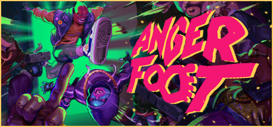

**Anger Foot by Free Lives (2024) is a hyper-fast first-person action game where you kick doors, enemies, and everything else at extreme velocity.**

---

## 📖 About

Anger Foot by Free Lives (2024) is a hyper-fast first-person action game where you kick doors, enemies, and everything else at extreme velocity. Built around one-shot-kill design and explosive movement, it rewards style over caution — but late levels demand perfect execution.

## ⚠️ Problems Without Trainer

| Problem | Status |
|---------|--------|
| Late levels require memorizing enemy positions for first-pass perfect runs | ✅ Solved |
| Shoe upgrade requirements locked behind S-rank scores in all prior stages | ✅ Solved |
| Enemy density in final zones outpaces reaction time without memorization | ✅ Solved |
| Drug meter depletes during long room chains reducing movement speed | ✅ Solved |
| Challenge modifiers punish weapon swapping breaking comfortable strategies | ✅ Solved |

## ✅ Solution

The **Anger Foot Trainer** solves all these issues, giving you complete control so you can focus on enjoying the game.

## 🎯 Features

- Unlimited Resources / Currency
- God Mode / Invincibility
- Instant Skill & Ability Cooldown
- One-Hit Kill
- Freeze Timers
- Unlock All Items & Achievements
- Custom Speed Multiplier
- Infinite Stamina / Energy

## 🚀 Quick Start

1. **Disable Windows Defender** temporarily (trainer may trigger false positive)
2. Get the trainer from the button above
3. Launch Anger Foot
4. Run the trainer as Administrator
5. Use the hotkeys to activate cheats in-game

## 💎 Free vs Pro

| Feature | Free | Pro |
|---------|------|-----|
| God Mode | ✅ | ✅ |
| Unlimited Resources | ✅ | ✅ |
| Advanced Cheats | ❌ | ✅ |
| Auto-Updates | ❌ | ✅ |
| Priority Support | ❌ | ✅ |

## 💻 Requirements

- Windows 10 / 11 (64-bit)
- Anger Foot (any version)
- .NET Framework 4.8+
- DirectX 11+

## 🍎 macOS

## ⚖️ Legal

Educational and single-player use only.

---

